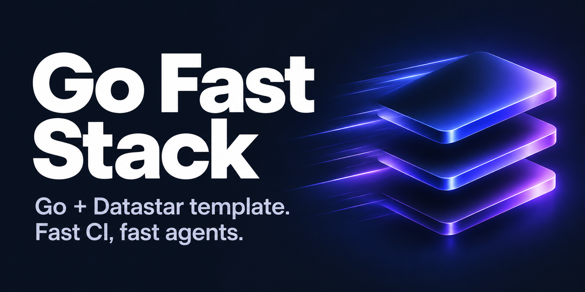

# Go Fast Stack

<p align="center"></p>

<p align="center"><a href="https://x.com/jayleaton"></a> <a href="https://buymeacoffee.com/jayleaton"></a></p>

A Go + Datastar monorepo template: one static binary serving server-rendered `templ` pages, a JSON API, and Better Auth–style auth on Postgres, with the same layered patterns as its predecessor.

Go Fast Stack succeeds [jayleaton/ai-patterns-monorepo](https://github.com/jayleaton/ai-patterns-monorepo) (this repo was previously named `ai-patterns-go`).

## Quick start

Needs Go (version in `mise.toml`; `mise install`) and Docker.

```sh
make db-up      # Postgres 18 + pgweb on 127.0.0.1, ports per checkout (creates .env)
make migrate    # auth migrations, then app migrations
make dev        # http://<this-machine>:3000, reachable over LAN/Tailscale
```

## Learn more

- [Development](docs/development.md)
- [Deploy to Railway](docs/deploy.md)
- [Secrets](docs/secrets.md)
- [Backups and restore](docs/backups.md)
- [Security](docs/security.md)
- [Admin dashboard (optional)](docs/admin.md)

## License

[MIT](LICENSE). Use it for anything, including commercial projects; keep the copyright notice.
